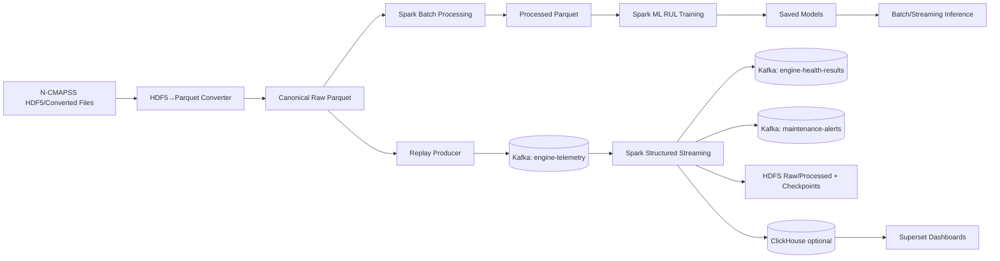

# Aircraft Engine Predictive Maintenance Pipeline

English + Arabic quick guide for a practical first version of an end-to-end pipeline.

## 1) Architecture / المعمارية



العربي: النظام يقسم مسار البيانات إلى **Batch** و **Streaming** مع تخزين في HDFS، تنبيهات عبر Kafka، وتحليلات في ClickHouse/Superset.

## 2) Defaults / القيم الافتراضية

- Kafka inside Docker: `kafka:9092`
- HDFS inside Docker: `hdfs://namenode:9000`
- ClickHouse HTTP inside Docker: `http://clickhouse:8123`
- Topics: `engine-telemetry`, `engine-health-results`, `maintenance-alerts`
- HDFS dirs: `/aircraft/raw`, `/aircraft/processed`, `/aircraft/checkpoints`, `/aircraft/models`, `/aircraft/quarantine`

Copy `.env.example` to `.env` and adjust as needed.

## 3) Install

```bash
python -m pip install -e .[dev,spark]
```

## 4) HDF5 -> Parquet conversion

The converter recursively inspects `.h5/.hdf5`, supports chunking, and writes partitioned Snappy Parquet.

```bash
aircraft-convert \
  --input-dir ./data/ncmapss \
  --output-dir ./data/canonical_parquet \
  --chunk-size 5000 \
  --mapping ./src/aircraft_pm/config/ncmapss_mapping.example.json \
  --quarantine-report ./reports/quarantine.jsonl
```

Windows PowerShell:

```powershell
aircraft-convert --input-dir .\data\ncmapss --output-dir .\data\canonical_parquet --chunk-size 5000 --mapping .\src\aircraft_pm\config\ncmapss_mapping.example.json --quarantine-report .\reports\quarantine.jsonl
```

HDFS upload example (inside NameNode container):

```bash
hdfs dfs -mkdir -p /aircraft/raw
hdfs dfs -put -f ./data/canonical_parquet/* /aircraft/raw/
```

## 5) Spark batch job

```bash
spark-submit \
  --master spark://spark-master:7077 \
  src/aircraft_pm/jobs/batch_job.py \
  --input /aircraft/raw \
  --output /aircraft/processed \
  --clickhouse-url http://clickhouse:8123
```

Arabic: الوظيفة تنظف الأنواع، تولّد cycle إذا لزم، وتولد RUL من `max(cycle)-cycle` فقط إذا labels غير موجودة وبوجود cycle.

## 6) Streaming path

Replay producer:

```bash
aircraft-replay --input-parquet ./data/canonical.parquet --bootstrap-servers kafka:9092 --topic engine-telemetry --batch-size 200 --rate-per-sec 5 --loop
```

Structured Streaming (Spark):

```bash
spark-submit \
  --master spark://spark-master:7077 \
  --packages org.apache.spark:spark-sql-kafka-0-10_2.12:3.5.1 \
  src/aircraft_pm/jobs/streaming_job.py \
  --bootstrap-servers kafka:9092 \
  --input-topic engine-telemetry \
  --results-topic engine-health-results \
  --alerts-topic maintenance-alerts \
  --raw-output /aircraft/raw \
  --checkpoint-base /aircraft/checkpoints \
  --dead-letter-path /aircraft/quarantine/invalid_messages
```

Invalid JSON is routed to DLQ topic/file.

## 7) RUL ML (Spark MLlib)

```bash
spark-submit --master spark://spark-master:7077 src/aircraft_pm/jobs/ml_train.py --input /aircraft/processed --model-path /aircraft/models
```

- Split is by engine/unit to avoid trajectory leakage.
- Models: Linear Regression + Random Forest (+ GBT).
- Metrics: MAE/RMSE.
- If labels are missing, training exits with explicit error (no silent fabrication).

Inference:

```bash
spark-submit --master spark://spark-master:7077 src/aircraft_pm/jobs/ml_predict.py --model-path /aircraft/models/random_forest --input /aircraft/processed --output /aircraft/predictions
```

## 8) ClickHouse + Superset

Apply schema:

```bash
clickhouse-client --host clickhouse --queries-file src/aircraft_pm/sql/clickhouse_schema.sql
```

Superset ClickHouse URI:

- Inside Docker Superset: `clickhousedb://default@clickhouse:8123/aircraft`
- From host tools: `http://localhost:8123`

Arabic: داخل Docker استخدم اسم الخدمة (مثل `clickhouse`) وليس `localhost`.

## 9) Observability demo / دليل التحقق

```bash
aircraft-status --bootstrap-servers kafka:9092 --topic engine-telemetry --spark-master-ui http://spark-master:8080 --clickhouse-url http://clickhouse:8123
```

Runbook:
1. Start streaming Spark job.
2. Start replay producer.
3. Watch `aircraft-status` output (lag, spark JSON status, CH row counts).
4. Open Kafka UI and confirm message growth.
5. Inspect HDFS `/aircraft/raw` and `/aircraft/checkpoints`.
6. Query ClickHouse tables.

## 10) CI/CD

Workflow: `.github/workflows/ci.yml`
- Ruff lint
- Pytest unit tests
- Lightweight converter integration smoke test (no external Docker needed)

## 11) Dataset assumptions / افتراضات البيانات

- Kaggle/N-CMAPSS exports vary by group/dataset names.
- Use mapping file (`--mapping`) to define expected dataset column names and optional `engine_id_column`.
- Unsupported arrays or malformed datasets are reported to quarantine JSONL.
- Never commit downloaded datasets, generated parquet, or model artifacts.

## 12) Single-host note

Current local setup is single-host. True multi-node distribution requires additional hosts/networking.
